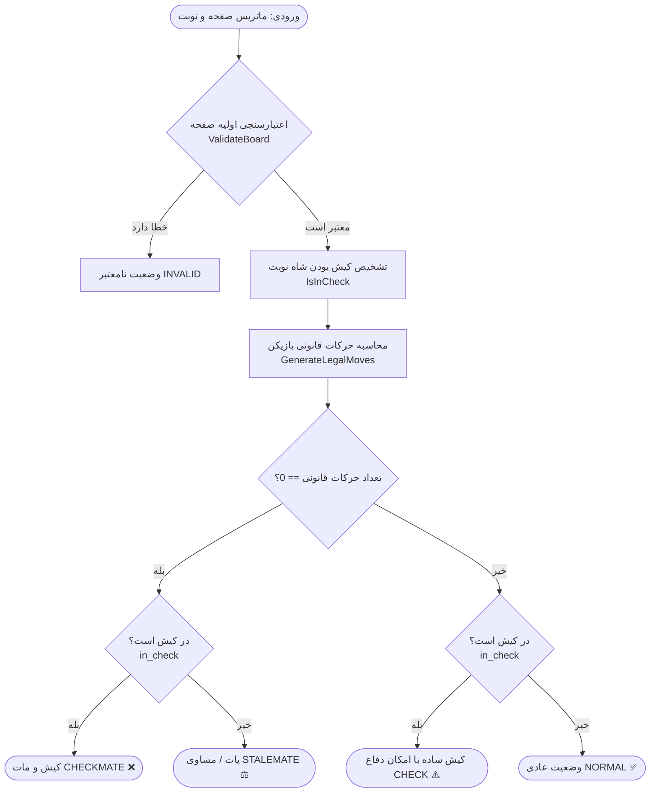

# مستندات فنی و الگوریتمی پروژه CheckmateCheck ♟️
### الگوریتم‌های تشخیص کیش و مات، پات، کیش و ارزیابی وضعیت صفحه شطرنج

---

## فهرست مطالب
1. [مقدمه و نمای کلی](#۱-مقدمه-و-نمای-کلی)
2. [فرمولاسیون ریاضی و فضای حالت](#۲-فرمولاسیون-ریاضی-و-فضای-حالت)
3. [ساختار داده و مدل‌سازی صفحه](#۳-ساختار-داده-و-مدل‌سازی-صفحه)
4. [الگوریتم‌های هسته محاسباتی](#۴-الگوریتم‌های-هسته-محاسباتی)
   - [۴.۱. الگوریتم اعتبارسنجی صفحه (Validation)](#۴۱-الگوریتم-اعتبارسنجی-صفحه)
   - [۴.۲. الگوریتم تابش معکوس پرتو (Reverse Raycasting)](#۴۲-الگوریتم-تابش-معکوس-پرتو)
   - [۴.۳. الگوریتم تشخیص کیش (In-Check Detection)](#۴۳-الگوریتم-تشخیص-کیش)
   - [۴.۴. الگوریتم تفکیک حرکات شبه‌قانونی و قانونی (Make-and-Verify)](#۴۴-الگوریتم-تفکیک-حرکات-شبه‌قانونی-و-قانونی)
   - [۴.۵. الگوریتم تصمیم‌گیری نهایی وضعیت](#۴۵-الگوریتم-تصمیم‌گیری-نهایی-وضعیت)
5. [شبه‌کد تفصیلی الگوریتم‌ها (Pseudocode)](#۵-شبه‌کد-تفصیلی-الگوریتم‌ها)
6. [دیاگرام‌های جریان داده (Flowcharts)](#۶-دیاگرام‌های-جریان-داده)
7. [تحلیل پیچیدگی زمانی و مکانی (Complexity Analysis)](#۷-تحلیل-پیچیدگی-زمانی-و-مکانی)
8. [مدیریت حالت‌های خاص (Edge Cases)](#۸-مدیریت-حالت‌های-خاص)

---

## ۱. مقدمه و نمای کلی

پروژه **CheckmateCheck** با هدف پیاده‌سازی مستقل و شفاف الگوریتم ارزیابی وضعیت‌های ایستا (Static Board State Evaluation) در بازی شطرنج طراحی شده است. بر خلاف موتورهای کامل بازی (مانند Stockfish) که نیازمند جستجوی درخت بازی (Minimax / Alpha-Beta Pruning) در عمق‌های آینده هستند، این سیستم منحصراً روی **ارزیابی قطعی وضعیت حاضر صفحه** متمرکز است و خروجی‌های زیر را تعیین می‌کند:

* **کیش و مات (Checkmate):** شکست قطعی بازیکن صاحب نوبت.
* **پات (Stalemate):** تساوی اجباری به دلیل نبود حرکت قانونی بدون کیش بودن.
* **کیش (Check):** تهدید مستقیم به شاه با وجود راه‌های دفاع.
* **وضعیت عادی (Normal):** عدم کیش و وجود حرکات قانونی در جریان بازی.
* **صفحه نامعتبر (Invalid):** نقض اصول اولیه قوانین فیزیکی شطرنج.

---

## ۲. فرمولاسیون ریاضی و فضای حالت

یک وضعیت صفحه با سه‌تایی مرتب $S$ تعریف می‌شود:

$$S = (B, t, \mathcal{M}_{\text{legal}})$$

که در آن:
* $B \in \mathcal{P}^{8 \times 8}$: ماتریس صفحه شامل مهره‌ها یا خانه‌های خالی.
* $t \in \{\text{'w'}, \text{'b'}\}$: بازیکن صاحب نوبت حرکت.
* $\neg t$: بازیکن حریف (غیرنوبت).
* $\mathcal{M}_{\text{legal}}$: مجموعه حرکات کاملاً قانونی بازیکن $t$.

### تعاریف گزاره‌ای وضعیت‌ها:

1. **تابع کیش بودن شاه ($\text{InCheck}(B, t)$):**
   $$\text{InCheck}(B, t) \iff \text{KingPos}(B, t) \in \text{AttackedSquares}(B, \neg t)$$

2. **کیش و مات ($\text{Checkmate}$):**
   $$\text{Checkmate}(S) \iff \text{InCheck}(B, t) \land |\mathcal{M}_{\text{legal}}| = 0$$

3. **پات ($\text{Stalemate}$):**
   $$\text{Stalemate}(S) \iff \neg \text{InCheck}(B, t) \land |\mathcal{M}_{\text{legal}}| = 0$$

4. **کیش ساده ($\text{Check}$):**
   $$\text{Check}(S) \iff \text{InCheck}(B, t) \land |\mathcal{M}_{\text{legal}}| > 0$$

5. **وضعیت عادی ($\text{Normal}$):**
   $$\text{Normal}(S) \iff \neg \text{InCheck}(B, t) \land |\mathcal{M}_{\text{legal}}| > 0$$

### ماتریس تصمیم‌گیری (Decision Matrix):

| وضعیت کیش ($\text{InCheck}$)| تعداد حرکات قانونی ($|\mathcal{M}_{\text{legal}}|$) | خروجی الگوریتم | برچسب فارسی |
| :---: | :---: | :---: | :---: |
| **True** | **$0$** | `CHECKMATE` | کیش و مات ❌ |
| **False** | **$0$** | `STALEMATE` | پات (مساوی) ⚖️ |
| **True** | **$> 0$** | `CHECK` | کیش ⚠️ |
| **False** | **$> 0$** | `NORMAL` | وضعیت عادی ✅ |

---

## ۳. ساختار داده و مدل‌سازی صفحه

### ۳.۱. ماتریس دوبعدی صفحه (`Board.grid`)
صفحه شطرنج به عنوان یک آرایه دوبعدی $8 \times 8$ در حافظه مدل‌سازی شده است:
* `row = 0` معادل عرض ۸ (سمت مهره‌های سیاه در شروع استاندارد).
* `row = 7` معادل عرض ۱ (سمت مهره‌های سفید در شروع استاندارد).
* `col = 0` معادل ستون `a` تا `col = 7` معادل ستون `h`.

### ۳.۲. نگاشت مختصات (Coordinate Mapping)
توابع نگاشت دوطرفه بین نماد جبری شطرنجی (مانند `"e4"`) و اندیس‌های ماتریس:

$$\text{col} = \text{ord}(\text{file}) - \text{ord}('a')$$
$$\text{row} = 8 - \text{rank}$$

$$\text{file} = \text{chr}(\text{ord}('a') + \text{col})$$
$$\text{rank} = 8 - \text{row}$$

### ۳.۳. مدل شیء مهره (`Piece`)
هر مهره شامل دو ویژگی کلیدی است:
* `color`: رنگ مهره (`'w'` یا `'b'`).
* `piece_type`: نماد مهره (`'P'`, `'N'`, `'B'`, `'R'`, `'Q'`, `'K'`).

---

## ۴. الگوریتم‌های هسته محاسباتی

### ۴.۱. الگوریتم اعتبارسنجی صفحه (`validate_board`)
پیش از ورود به محاسبات سنگین، ۴ شرط اساسی زیر در زمان $O(1)$ بررسی می‌شوند:
1. **شمارش شاه‌ها:** وجود دقیقاً ۱ شاه سفید و ۱ شاه سیاه ($\text{Count}(K_w) = 1 \land \text{Count}(K_b) = 1$).
2. **عدم همجواری دو شاه:** فاصله اقلیدسی یا چبیشف دو شاه باید حداقل ۲ خانه باشد:
   $$\max(|r_{K_w} - r_{K_b}|, |c_{K_w} - c_{K_b}|) > 1$$
3. **محدودیت عرض پیاده‌ها:** هیچ پیاده‌ای نباید در عرض‌های ۱ و ۸ قرار داشته باشد (زیرا طبق قانون ترفیع، پیاده با رسیدن به عرض آخر بلافاصله به مهره دیگری تبدیل می‌شود).
4. **عدم کیش بودن شاه بازیکن غیرنوبت:** اگر نوبت با سفید است، شاه سیاه نمی‌تواند در کیش باشد. چرا که در شطرنج قانونی، بازیکن مجاز نیست نوبت را به پایان برساند و شاه خود را در کیش رها کند.

---

### ۴.۲. الگوریتم تابش معکوس پرتو (Reverse Raycasting)
یکی از بهینه‌ترین نوآوری‌ها در تابع `get_attackers_of_square`، استفاده از **تابش پرتو معکوس** به جای پیمایش کل مهره‌های دشمن است.

> **ایده اصلی:** به جای اینکه برای تک‌تک مهره‌های حریف بررسی کنیم که آیا به خانه $(r, c)$ می‌رسند یا خیر، از خودِ خانه $(r, c)$ پرتوهایی به تمام جهات شلیک می‌کنیم تا ببینیم اولین مهره‌ای که در مسیر دیده می‌شود آیا توانایی حمله به این خانه را دارد یا خیر.

* **پرتوهای راست‌خط (Orthogonal Rays):** در ۴ جهت اصلی $(\pm 1, 0)$ و $(0, \pm 1)$ حرکت می‌کنیم تا به اولین مانع برسیم؛ اگر مهره دیده شده رخ یا وزیر حریف بود $\rightarrow$ خانه تحت حمله است.
* **پرتوهای مورب (Diagonal Rays):** در ۴ قطر اصلی $(\pm 1, \pm 1)$ حرکت می‌کنیم؛ اگر اولین مهره دیده شده فیل یا وزیر حریف بود $\rightarrow$ خانه تحت حمله است.
* **جهش‌های اسب (Knight Offsets):** بررسی مستقیم ۸ مختصات ناشی از آفست‌های $(\pm 1, \pm 2)$ و $(\pm 2, \pm 1)$.
* **ضربدر پیاده (Pawn Checks):** بسته به رنگ مهره مهاجم، ۲ خانه مورب روبرو بررسی می‌شود.

**مزیت:** در هر جهت، پرتو با رسیدن به اولین مهره بلافاصله متوقف (`break`) می‌شود؛ بنابراین مهره‌های پشت سد به هیچ عنوان بررسی بیهوده نمی‌شوند.

---

### ۴.۳. الگوریتم تشخیص کیش (`is_in_check`)
این الگوریتم در ۳ مرحله عمل می‌کند:
1. موقعیت شاه رنگ $t$ در صفحه پیدا می‌شود: $(r_K, c_K) = \text{find\_king}(B, t)$.
2. اگر شاه پیدا نشد $\rightarrow$ خروجی `False`.
3. با استفاده از تابع `is_square_attacked` بررسی می‌شود که آیا خانه $(r_K, c_K)$ توسط رنگ رقیب ($\neg t$) تحت حمله است یا خیر.

---

### ۴.۴. الگوریتم تفکیک حرکات شبه‌قانونی و قانونی (Make-and-Verify)

در شطرنج، حرکات به دو دسته تقسیم می‌شوند:
1. **حرکات شبه‌قانونی (Pseudo-Legal):** حرکاتی که بر اساس قوانین هندسی حرکت مهره مجازند (مثلاً اسب ۲ خانه به جلو و ۱ خانه به راست می‌رود و روی مهره خودی نمی‌نشیند).
2. **حرکات قانونی (Legal):** حرکات شبه‌قانونی‌ای که **باعث کیش ماندن یا کیش شدن شاه خودی نشوند**.

#### شیوه حل آچمز (Pins) با الگوریتم Make-and-Verify:
```
           [تولید یک حرکت شبه‌قانونی m]
                       │
                       ▼
       ساخت یک کپی مستقل از صفحه: B' = clone(B)
                       │
                       ▼
          اعمال فرضی حرکت روی صفحه کپی:
              B'.make_move(m)
                       │
                       ▼
             آیا is_in_check(B', t) ؟
             ├── بله ──> حرکت غیرقانونی است (رد حرکت)
             └── خیر ──> حرکت کاملاً قانونی است (افزودن به لیست)
```

> **نکته کلیدی علمی:** با این معماری، هیچ نیازی به کدنویسی جداگانه برای «تشخیص مهره‌های آچمز» وجود ندارد. اگر مهره‌ای آچمز باشد، با حرکت کردن آن، خط حمله مهره دشمن به روی شاه باز می‌شود و تابع `is_in_check` روی صفحه شبیه‌سازی‌شده مقدار `True` بازمی‌گرداند؛ در نتیجه حرکت خودبه‌خود فیلتر می‌گردد.

---

### ۴.۵. الگوریتم تصمیم‌گیری نهایی وضعیت
پس از تکمیل فیلتر حرکات قانونی، خروجی نهایی به شکل زیر مشخص می‌شود:

1. اگر $|\mathcal{M}_{\text{legal}}| == 0$:
   - اگر $\text{in\_check} == \text{True}$ $\rightarrow$ **کیش و مات (CHECKMATE)**
   - اگر $\text{in\_check} == \text{False}$ $\rightarrow$ **پات (STALEMATE)**
2. اگر $|\mathcal{M}_{\text{legal}}| > 0$:
   - اگر $\text{in\_check} == \text{True}$ $\rightarrow$ **کیش (CHECK)**
   - اگر $\text{in\_check} == \text{False}$ $\rightarrow$ **وضعیت عادی (NORMAL)**

همچنین، حرکات قانونی هر دو طرف در قالب دیکشنری `moves_by_square` سازماندهی می‌شوند تا در زمان $O(1)$ مقاصد مجاز هر مهره با کلیک کاربر روی صفحه هایلایت گردند.

---

## ۵. شبه‌کد تفصیلی الگوریتم‌ها (Pseudocode)

### الگوریتم ۱: تابش پرتو معکوس برای بررسی خانه تحت حمله
```text
Algorithm: IsSquareAttacked(Board B, target_r, target_c, by_color)
Input: Board state B, target coordinates (target_r, target_c), attacker color
Output: Boolean (True if attacked, False otherwise)

1. // ۱. بررسی حملات اسب
   For each (dr, dc) in KNIGHT_OFFSETS:
       nr = target_r + dr,  nc = target_c + dc
       If IsValidCoord(nr, nc) and B[nr][nc] is Knight of by_color:
           Return True

2. // ۲. بررسی حملات پیاده
   pawn_r = (by_color == 'w') ? target_r + 1 : target_r - 1
   For each dc in [-1, +1]:
       pawn_c = target_c + dc
       If IsValidCoord(pawn_r, pawn_c) and B[pawn_r][pawn_c] is Pawn of by_color:
           Return True

3. // ۳. بررسی پرتوهای مستقیم رخ و وزیر
   For each (dr, dc) in ROOK_DIRECTIONS:
       curr_r = target_r + dr,  curr_c = target_c + dc
       While IsValidCoord(curr_r, curr_c):
           piece = B[curr_r][curr_c]
           If piece is not Empty:
               If piece.color == by_color and piece.type in ['R', 'Q']:
                   Return True
               Break // سد مهره
           curr_r += dr,  curr_c += dc

4. // ۴. بررسی پرتوهای مورب فیل و وزیر
   For each (dr, dc) in BISHOP_DIRECTIONS:
       curr_r = target_r + dr,  curr_c = target_c + dc
       While IsValidCoord(curr_r, curr_c):
           piece = B[curr_r][curr_c]
           If piece is not Empty:
               If piece.color == by_color and piece.type in ['B', 'Q']:
                   Return True
               Break // سد مهره
           curr_r += dr,  curr_c += dc

5. // ۵. بررسی همجواری شاه حریف
   For each (dr, dc) in KING_OFFSETS:
       nr = target_r + dr,  nc = target_c + dc
       If IsValidCoord(nr, nc) and B[nr][nc] is King of by_color:
           Return True

6. Return False
```

---

### الگوریتم ۲: تولید حرکات قانونی (GenerateLegalMoves)
```text
Algorithm: GenerateLegalMoves(Board B, color)
Input: Board state B, player color
Output: List of strictly legal moves

1. pseudo_moves = GeneratePseudoLegalMoves(B, color)
2. legal_moves = []

3. For each move in pseudo_moves:
       // ایجاد صفحه شبیه‌سازی
       board_copy = B.Clone()
       board_copy.ApplyMove(move)
       
       // اعتبارسنجی کیش نبودن شاه خودی
       If not IsInCheck(board_copy, color):
           legal_moves.Append(move)

4. Return legal_moves
```

---

### الگوریتم ۳: ارزیابی کلان صفحه (EvaluateBoard)
```text
Algorithm: EvaluateBoard(Board B, active_turn)
Input: Board state B, active turn ('w' or 'b')
Output: Evaluation verdict object

1. (is_valid, error) = ValidateBoard(B, active_turn)
2. If not is_valid:
       Return { status: "INVALID", message: error }

3. in_check = IsInCheck(B, active_turn)
4. legal_moves = GenerateLegalMoves(B, active_turn)

5. If Length(legal_moves) == 0:
       If in_check:
           status = "CHECKMATE"
       Else:
           status = "STALEMATE"
   Else:
       If in_check:
           status = "CHECK"
       Else:
           status = "NORMAL"

6. moves_by_square = IndexMovesBySourceSquare(B)
7. Return { status, in_check, legal_moves_count: Length(legal_moves), moves_by_square }
```

---

## ۶. دیاگرام‌های جریان داده

### فلوچارت تصمیم‌گیری ارزیابی وضعیت:



---

## ۷. تحلیل پیچیدگی زمانی و مکانی

### ۷.۱. پیچیدگی زمانی (Time Complexity)
از آنجا که ابعاد صفحه در شطرنج ثابت ($N = 8 \times 8 = 64$) است، از نقطه نظر تئوری پیچیدگی کل برنامه $O(1)$ می‌باشد. اما از نقطه نظر تعداد عملیات پایه (Elementary Operations):

1. **تابع `is_square_attacked`:**
   - حداکثر $8$ پرتو مستقیم (طول حداکثر ۷).
   - حداکثر $8$ پرتو مورب (طول حداکثر ۷).
   - $8$ خانه اسب و ۲ خانه پیاده.
   - حداکثر تعداد بررسی خانه‌ها: کمتر از ۶۴ عملیات مستقیم در بدترین حالت.
2. **تابع `generate_pseudo_legal_moves`:**
   - پیمایش ۶۴ خانه صفحه. در بدترین حالت، یک بازیکن می‌تواند حداکثر حدود ۴۰ حرکت شبه‌قانونی داشته باشد.
3. **تابع `generate_legal_moves`:**
   - برای هر حرکت شبه‌قانونی (حداکثر ~۴۰ حرکت)، یک کپی از صفحه و یک بار اجرای `is_in_check` انجام می‌شود:
   $$T_{\text{eval}} \approx K \times T_{\text{check}} \approx 40 \times 64 \text{ ops} \approx 2500 \text{ ops}$$
   - این حجم عملیات روی هر پردازنده مدرنی در کسری از میلی‌ثانیه (کمتر از **۰.۰۰۱ ثانیه**) انجام می‌پذیرد.

### ۷.۲. پیچیدگی مکانی (Space Complexity)
* یک شیء `Board` شامل یک آرایه ۶۴ عضوی از ارجاعات اشیاء است ($64 \times 8 \text{ bytes} \approx 512 \text{ bytes}$).
* در فرآیند Make-and-Verify، کپی‌ها به صورت پشته‌ای ساخته و پس از پایان حلقه توسط Garbage Collector پایتون بازیافت می‌شوند.
* مصرف کل حافظه فرآیند ارزیابی در بازه چند کیلوبایت باقی می‌ماند: $O(1)$.

---

## ۸. مدیریت حالت‌های خاص

| سناریوی خاص | نحوه مدیریت در الگوریتم | خروجی مورد انتظار |
| :--- | :--- | :--- |
| **مهره آچمز (Absolute Pin)** | در شبیه‌سازی کپی صفحه، پرتو مهره مهاجم به شاه می‌رسد و `is_in_check = True` می‌شود؛ حرکت حذف می‌گردد. | عدم نمایش خانه‌های مقصد غیرمجاز برای مهره آچمز |
| **کیش دوگانه (Double Check)** | دو مهره همزمان به شاه حمله می‌کنند. تنها حرکات قانونی مجاز، حرکت خودِ شاه به خانه‌های امن خواهد بود. | فیلتر خودکار تمام حرکات مهره‌های دیگر، زیرا هیچ مهره‌ای نمی‌تواند همزمان دو خط حمله را ببندد |
| **پات بن‌بست پیاده‌ها (Pawn Lock)** | شاه در کیش نیست ولی پیاده‌ها و مهره‌ها مسدودند و شاه خانه‌ای برای حرکت ندارد. | تشخیص دقیق `STALEMATE` (پات) |
| **نبود شاه یا شاه‌های متعدد** | در مرحله `validate_board` شناسایی شده و مانع از اجرای ادامه فرآیند می‌شود. | وضعیت `INVALID` همراه با متن خطای فارسی |
| **همجواری دو شاه** | در مرحله `validate_board` با بررسی فاصله فاصله‌ای کمتر مساوی ۱ شناسایی می‌شود. | وضعیت `INVALID` به علت مجاورت شاه‌ها |
